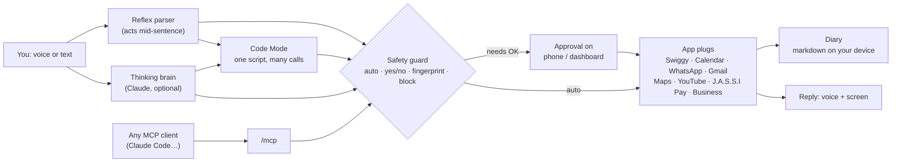

# J.A.S.S.I — Just Another Smart System Interface

**One assistant for all your apps. You talk, it acts, and a safety guard in code decides what needs your OK.**

wHACKiest 2026 · Track 1: *Make MCP Matter* · Team J.A.S.S.I (MSRIT) — Round 1 prototype.


> "Order my usual and put the delivery time in my calendar and WhatsApp Riya the ETA."
> → 3 apps, 1 Code Mode script, 12 ms. Safe steps start **while you are still talking**.

---

## What works in this prototype

| Feature | What you see |
|---|---|
| **Acts mid-sentence** | A fast grammar parser reads your words *as you speak* and starts safe steps (open an app, search, set a timer) before you finish the sentence. Each one gets a **⚡ "1.4 s before you finished"** badge. Money never moves mid-sentence. |
| **Code Mode** | Several steps in one sentence become **one small script** that runs every tool call in a sandbox: no AI round trip per step. You watch the script run line by line. |
| **Safety guard (in code, not in a prompt)** | Reading → automatic. Messages you send yourself → app link, you tap Send. Anything that reaches other people → **Yes/No**. Payments under ₹5,000 → automatic. ₹5,000 or more, over the ₹10,000 daily limit, or started by something it *read* → **fingerprint**. Bank, UPI and ID apps → **locked**. |
| **Prompt-injection guard** | "Read my emails" flags the scam email that tries to give the AI orders. *Test the guard* shows what happens if the AI obeys it: the payment is stopped and needs your fingerprint. |
| **MCP server** | Every J.A.S.S.I tool is also served over MCP at `/mcp`. Claude Code or any other MCP client gets **the same guard, approvals and diary**. |
| **Diary you own** | Every action (done, declined or blocked) is written as an Obsidian-style markdown note on your device: `data/diary/YYYY-MM-DD.md`. |
| **Business brief** | The first time you open it each day: sales vs usual, cash, overdue payments, low stock, quiet deals, meetings, and **3 next steps, one tap each**. |
| **Voice in and out** | Talk with the mic (Chrome speech recognition, en-IN). Replies are spoken back. Or type with *Like voice* on to watch mid-sentence actions without a mic. |
| **Thinking brain (optional)** | With an Anthropic key, questions and unknown tasks go to Claude with J.A.S.S.I's tools (plus `run_script` for Code Mode). Without a key it runs in quick mode. |

### Honest notes (Round 1)
- **Payments are test mode**: a local ledger that follows the Razorpay / UPI Reserve Pay rules. No real money moves.
- **Swiggy/Zomato and business data use a demo menu and demo numbers** (`data/demo.json`). In the product these come from the companies' official MCP servers.
- WhatsApp, email, Maps, YouTube and search are **real links**: J.A.S.S.I fills them in and you tap the last button.
- Calendar events are stored locally and download as real `.ics` files.
- The Code Mode sandbox is `node:vm` with only `tools.*` in scope. That's fine for a prototype. Production would use an isolated worker.
- The fingerprint is a hold-to-approve button that stands in for the phone's fingerprint prompt.

---

## Run it (no install, no dependencies)

Needs **Node 20+** and **Chrome** (for voice).

```bash
git clone https://github.com/Pulin-PC/J.A.S.S.I.git
cd J.A.S.S.I
npm start
```

Open **http://localhost:7777**. Tap the glowing core (or press **Space**) and talk, or type a command.

Optional: copy `.env.example` to `.env` and add `ANTHROPIC_API_KEY` to turn on the thinking brain.

**Try:**
- `Order my usual and put the delivery time in my calendar and WhatsApp Riya the ETA`
- `Open YouTube and search for lofi beats and set a timer for 10 minutes`
- `Order lunch for the team` (₹6,840 → fingerprint)
- `Pay 250 to Rahul for chai` (auto)
- `Read my emails` (scam check) · `Open Google Pay` (locked) · `Send payment reminders` (needs your OK) · `Brief me`

### Use J.A.S.S.I from Claude Code (MCP)

```bash
claude mcp add --transport http jassi http://localhost:7777/mcp
```

Then ask Claude Code to *"pay Aditi ₹6,000 for the hackathon parts using jassi"*. The fingerprint prompt pops up on the J.A.S.S.I dashboard, and Claude only gets the result after you approve.

### Tests

```bash
npm test
```

---

## How it works



| Folder | What's inside |
|---|---|
| `public/reflex.js` | The mid-sentence parser (runs in the browser and in Node). Splits a sentence into steps, decides which can start early, marks steps that depend on an earlier result. |
| `public/app.js`, `app.css`, `index.html` | The HUD: live speech, stability timer, action feed, Code Mode view, approvals, brief, timers. |
| `server/guard.js` | The safety guard. All the rules live here. |
| `server/tools.js` | The app plugs and `call()`, the single door every action goes through (guard → your OK → run → diary). |
| `server/codemode.js` | Builds and runs Code Mode scripts in a sandbox. |
| `server/brain.js` | Optional Claude brain with tool use. |
| `server/mcp.js` | MCP server (Streamable HTTP, JSON-RPC). |
| `server/store.js` | Local state, approvals, live events, the markdown diary. |
| `data/demo.json` | Demo contacts, menu, emails and business numbers. |

**How "mid-sentence" works:** every time the speech engine sends new words, the whole sentence is parsed again into clauses (`open youtube` | `search for lofi beats` | `set a timer…`). A clause starts as soon as it is safe:
- **finished clauses** (you have moved on: "… and \<verb\>") start right away;
- **the clause you're still saying** starts early only if it isn't free text and its meaning has held steady for 140 ms;
- **free text** ("saying …", "search …") waits until the clause ends;
- **money and dependent steps** ("the ETA") wait for the end of the sentence and run together as one Code Mode script.

## What's next (final round)
Real official MCP plugs (Swiggy, Zomato, Google, Razorpay test keys), the phone app for approvals with a real fingerprint (AWS relay), ElevenLabs voice, and Graphify memory over the diary.

---
MIT licence · Built for wHACKiest 2026 (CodeRIT, Ramaiah Institute of Technology).
