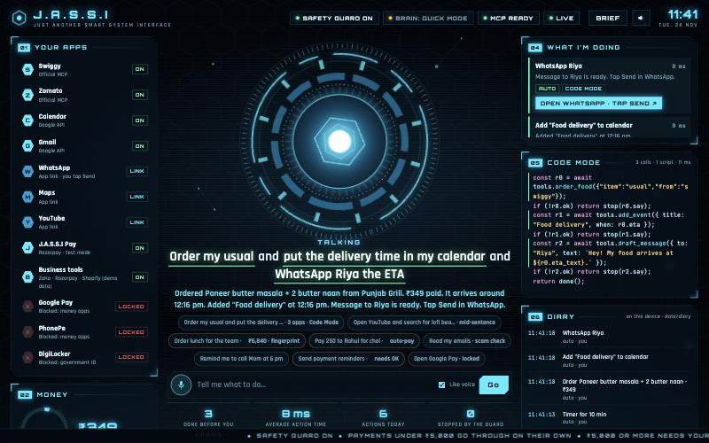
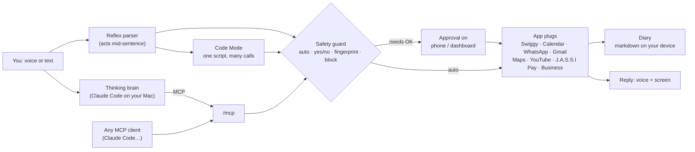

# J.A.S.S.I — Just Another Smart System Interface

**One assistant for all your apps. You talk, it acts, and a safety guard in code decides what needs your OK.**

wHACKiest 2026 · Track 1: *Make MCP Matter* · Team J.A.S.S.I (MSRIT) — Round 1 prototype.

**Live:** https://jassi.pulin-chaudhari.workers.dev (Cloudflare Workers + Durable Objects)



> "Order my usual and put the delivery time in my calendar and WhatsApp Riya the ETA."
> → 3 apps, 1 Code Mode script, 12 ms. Safe steps start **while you are still talking**.

---

## What works in this prototype

| Feature | What you see |
|---|---|
| **Acts mid-sentence** | A fast grammar parser reads your words *as you speak* and starts safe steps (open an app, search, set a timer) before you finish the sentence. Each one gets a **⚡ "1.4 s before you finished"** badge. Money never moves mid-sentence. |
| **Code Mode** | Several steps in one sentence become **one small script** that runs every tool call in a sandbox: no AI round trip per step. You watch the script run line by line. |
| **Safety guard (in code, not in a prompt)** | Reading → automatic. Messages you send yourself → app link, you tap Send. Anything that reaches other people → **Yes/No**. Payments under ₹5,000 → automatic. ₹5,000 or more, over the ₹10,000 daily limit, or started by something it *read* → **fingerprint**. Bank, UPI and ID apps → **locked**. |
| **Prompt-injection guard** | "Read my emails" flags the scam email that tries to give the AI orders. *Test the guard* shows what happens if the AI obeys it: the payment is stopped and needs your fingerprint. |
| **MCP server** | Every J.A.S.S.I tool is also served over MCP at `/mcp`. Claude Code or any other MCP client gets **the same guard, approvals and diary**. |
| **Diary you own** | Every action (done, declined or blocked) is written as an Obsidian-style markdown note on your device: `data/diary/YYYY-MM-DD.md`. |
| **Business brief** | The first time you open it each day: sales vs usual, cash, overdue payments, low stock, quiet deals, meetings, and **3 next steps, one tap each**. |
| **Voice in and out** | Talk with the mic (Chrome speech recognition, en-IN). Replies are spoken back. Or type with *Like voice* on to watch mid-sentence actions without a mic. |
| **Thinking brain = Claude Code** | Questions and tasks the quick parser doesn't know go to **Claude Code running on your Mac** (your own login, no API key; Haiku 5.5, medium effort). One warm process, so answers are fast. It acts only through J.A.S.S.I's MCP tools, so the same guard checks everything. Once it has read an email or page, its payments need your fingerprint. |

### Honest notes (Round 1)
- **Payments are test mode**: a local ledger that follows the Razorpay / UPI Reserve Pay rules. No real money moves.
- **Swiggy/Zomato and business data use a demo menu and demo numbers** (`data/demo.json`). In the product these come from the companies' official MCP servers.
- WhatsApp, email, Maps, YouTube and search are **real links**: J.A.S.S.I fills them in and you tap the last button.
- Calendar events are stored locally and download as real `.ics` files.
- Code Mode from your sentence runs everywhere. Free-form scripts written by an AI client (`run_script`) run only in the local version (`node:vm` sandbox, prototype). Cloudflare Workers don't allow running new code at runtime.
- The brain runs on your Mac. If it's offline, everything except open questions still works.
- The fingerprint is a hold-to-approve button that stands in for the phone's fingerprint prompt.

---

## Sign-in, setup and settings

- **Google sign-in, invite only.** The owner (set by `OWNER_EMAIL`) makes invite links in **⚙ Settings → Invites**. Nobody gets in without one.
- **Everyone gets their own private J.A.S.S.I**: their own apps, wallet, money rules, approvals and diary (one Durable Object per person).
- **First-time setup:** welcome → microphone and alerts → **connect your apps** (tick them; bank, UPI and ID apps stay locked) → **money rules** (sliders: auto-pay limit up to ₹5,000, daily limit) → try a first command.
- **Real Google Calendar and Gmail** once you press *Connect*: events go into your real calendar, and "read my emails" reads your real inbox (read-only; the scam check still applies).
- **⚙ Settings:** Account · Apps · Money rules · Brain (questions left today) · Voice · Invites (owner) · AI apps (your personal MCP link and key) · Diary & data.
- **Brain limits:** the owner has no limit; invited people get 30 questions a day. Each person gets their own Claude Code process, so conversations never mix.
- **Works on phones:** it's a web app. Use *Add to Home Screen* and it opens like an app.

## Run it

**Easiest:** open the live site, https://jassi.pulin-chaudhari.workers.dev, and sign in with Google (invite only).

**On your own computer** (no install, no dependencies). Needs **Node 20+** and **Chrome** (for voice).

```bash
git clone https://github.com/Pulin-PC/J.A.S.S.I.git
cd J.A.S.S.I
npm start
```

Open the address it prints in the terminal. Tap the glowing core (or press **Space**) and talk, or type a command.

`npm start` also starts the brain: Claude Code on this Mac with **your own login** (no API key). If Claude Code says you're logged out, run `claude` and type `/login`, or pin a long-lived token to your account with `zsh brain/link_claude.sh`. Model and effort: `JASSI_CLAUDE_MODEL` / `JASSI_CLAUDE_EFFORT` in `.env` (default Haiku 5.5, medium).

**Try:**
- `Order my usual and put the delivery time in my calendar and WhatsApp Riya the ETA`
- `Open YouTube and search for lofi beats and set a timer for 10 minutes`
- `Order lunch for the team` (₹6,840 → fingerprint)
- `Pay 250 to Rahul for chai` (auto)
- `Read my emails` (scam check) · `Open Google Pay` (locked) · `Send payment reminders` (needs your OK) · `Brief me`

### Hosted on Cloudflare

The same tools, guard and MCP code run on **Cloudflare Workers**. One **Durable Object** keeps the state, approvals, live updates and the diary (download it at `/api/diary.md`). The dashboard is served as static assets. No other database.

```bash
npx wrangler@4 login
npx wrangler@4 deploy
openssl rand -hex 24 | npx wrangler@4 secret put BRAIN_TOKEN   # private link for the brain
openssl rand -hex 32 | npx wrangler@4 secret put SESSION_SECRET  # signs sign-in cookies
npx wrangler@4 secret put GOOGLE_CLIENT_ID
npx wrangler@4 secret put GOOGLE_CLIENT_SECRET
npx wrangler@4 secret put OWNER_EMAIL                              # your Google email = owner
```

Then put `JASSI_CLOUD_URL=https://<your-worker>.workers.dev` and `JASSI_CLOUD_BRAIN_TOKEN=<same token>` in `.env`, and connect the brain from your Mac:

```bash
npm run brain:cloud
```

To start the brain by itself every time you log in to your Mac (macOS launchd): `zsh brain/autostart.sh` (turn off: `zsh brain/autostart.sh off`, log: `~/.jassi/brain.log`).

### Use J.A.S.S.I from Claude Code (MCP)

Sign in to the live site, open **⚙ Settings → AI apps**, and copy your personal command. It looks like this:

```bash
claude mcp add --transport http jassi https://jassi.pulin-chaudhari.workers.dev/mcp --header "Authorization: Bearer <your jk_ key from Settings>"
```

Then ask Claude Code to *"pay Aditi ₹6,000 for the hackathon parts using jassi"*. The fingerprint prompt pops up on the J.A.S.S.I dashboard, and Claude only gets the result after you approve.

### Tests

```bash
npm test
```

---

## How it works



| Folder | What's inside |
|---|---|
| `public/reflex.js` | The mid-sentence parser (runs in the browser and in Node). Splits a sentence into steps, decides which can start early, marks steps that depend on an earlier result. |
| `public/app.js`, `app.css`, `index.html` | The HUD: live speech, stability timer, action feed, Code Mode view, approvals, brief, timers. |
| `server/guard.js` | The safety guard. All the rules live here. |
| `server/tools.js` | The app plugs and `call()`, the single door every action goes through (guard → your OK → run → diary). |
| `server/codemode.js` | Builds Code Mode scripts from your sentence and runs them. |
| `server/sandbox.js` | Free-form Code Mode scripts in a `node:vm` sandbox (local only). |
| `server/brain.js` | Hands questions to the Claude Code brain and waits for its answer. |
| `brain/bridge.js` | The brain: one warm Claude Code process on your Mac (your login), acting through J.A.S.S.I's MCP tools. |
| `server/mcp.js` | MCP server (Streamable HTTP, JSON-RPC). |
| `server/api.js`, `server/runtime.js` | API routes and shared runtime used by both hosts. |
| `server/store.js`, `server/index.js` | Local host: files on your device, Node server. |
| `worker/index.js`, `wrangler.jsonc` | Cloudflare host: Worker + Durable Object. |
| `data/demo.json` | Demo contacts, menu, emails and business numbers. |

**How "mid-sentence" works:** every time the speech engine sends new words, the whole sentence is parsed again into clauses (`open youtube` | `search for lofi beats` | `set a timer…`). A clause starts as soon as it is safe:
- **finished clauses** (you have moved on: "… and \<verb\>") start right away;
- **the clause you're still saying** starts early only if it isn't free text and its meaning has held steady for 140 ms;
- **free text** ("saying …", "search …") waits until the clause ends;
- **money and dependent steps** ("the ETA") wait for the end of the sentence and run together as one Code Mode script.

## What's next (final round)
Real official MCP plugs (Swiggy, Zomato, Google, Razorpay test keys), the phone app for approvals with a real fingerprint (AWS relay), ElevenLabs voice, and Graphify memory over the diary.

---
MIT licence · Built for wHACKiest 2026 (CodeRIT, Ramaiah Institute of Technology).
